<div align="center">


# Cloudless-AI: private AI chat that runs offline in your browser

**A ChatGPT and Claude-style assistant that runs local LLMs on your own CPU or GPU.**
<br>No server. No account. No API key. Your chats never leave your device.

<br />

[](https://github.com/lokendra-builds/Cloudless-AI/stargazers)

[](https://lokendra-builds.github.io/Cloudless-AI/)
&nbsp;
[](LICENSE)
&nbsp;
[](#where-your-data-lives)
&nbsp;
[](#local-models)

---

Every chat you type into a hosted AI goes to someone else's computer. Cloudless-AI flips that: the model downloads once into your browser and answers from your own processor or graphics card. Close the network tab and it keeps working.

**[Live demo](https://lokendra-builds.github.io/Cloudless-AI/)** · [Quick start](#quick-start) · [Features](#features) · [Models](#local-models) · [Privacy](#where-your-data-lives) · [FAQ](#faq)

<br />

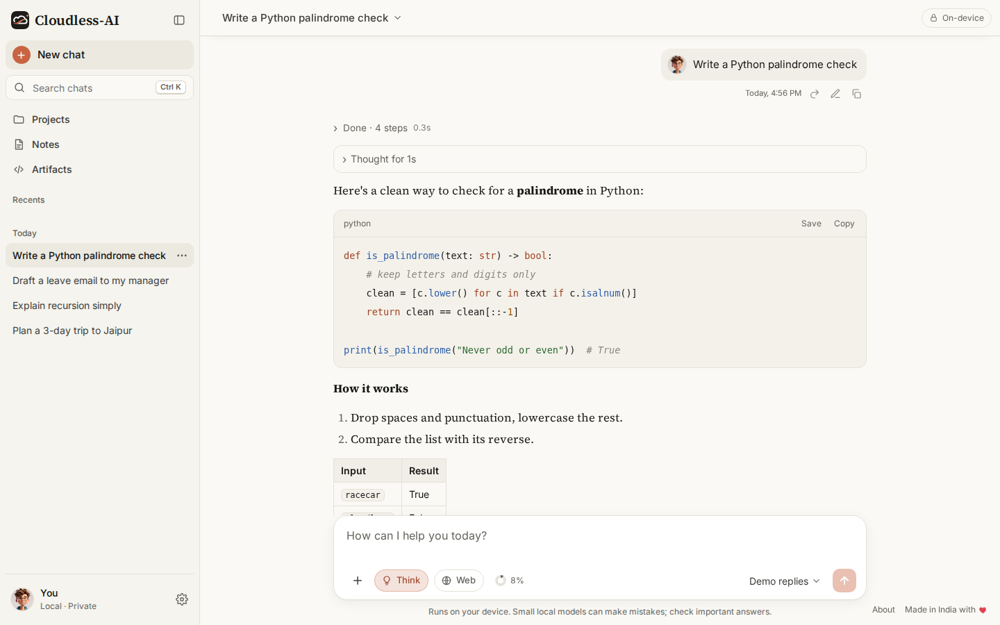

</div>

## Why Cloudless-AI

- 🔑 **No LLM API, no API key.** No OpenAI, Claude or Gemini account, no token bills. The model itself runs on your machine.
- 🖥️ **No backend.** It's a static web page. There is no server to deploy, nothing to pay for, and nothing that stores your data.
- 🔒 **Private by design.** Chats, projects, notes, artifacts and settings stay in your browser (IndexedDB). Nothing is uploaded.
- ✈️ **Works offline.** After the first download the model is cached, so it keeps working with the network off.
- ⚡ **Runs on any computer.** CPU mode (WebAssembly) works everywhere; GPU mode (WebGPU) is faster where it's available.
- 🧠 **Real open models.** Qwen3, Llama 3.2, Gemma, Phi-3.5 and more, from 0.4 GB, with a Think mode for harder questions.
- 🌐 **Optional web lookups.** Wikipedia, DuckDuckGo and link reading, off until you turn them on, with source links in every answer.
- 🔗 **Share artifacts without a server.** Save a page, image, document or code as an artifact and share it as a link: the whole artifact is packed inside the link and opens in the other person's browser.
- 💬 **Feels like Claude.** Projects, notes, artifacts, Markdown and code, live HTML preview, Ctrl+K palette, dark mode, phones.

## Quick start

1. Open the **[live demo](https://lokendra-builds.github.io/Cloudless-AI/)**.
2. Type a message. Cloudless-AI asks once before it downloads a model (Qwen3 1.7B, about 1.1 GB). Want it smaller? Pick Qwen3 0.6B (0.4 GB) from the model menu.
3. Chat. The model is now cached, so next time it loads by itself, even offline.

Want to run it yourself? It's a static site with no build step:

```bash
git clone https://github.com/lokendra-builds/Cloudless-AI.git
cd Cloudless-AI
python3 -m http.server 8081
# open http://localhost:8081
```

## Features

| | |
|---|---|
| **Familiar chat** | Streaming replies, Markdown, tables, highlighted code with a copy button. Every message shows its date and time, with copy, resend, edit, retry and stop. |
| **Live HTML preview** | When a reply contains a web page, it opens in a panel on the right and runs there, sandboxed and offline. Switch between Preview and Code, copy or download it. |
| **Projects** | Group chats and notes. Give a project its own instructions and knowledge files; every chat inside uses them. |
| **Notes** | Markdown notes on their own or inside a project. Save any AI reply as a note in one click. |
| **Artifacts** | HTML pages, SVG images, Markdown documents and code files you keep, on their own or inside a project. Press **Save** on any code block in a reply, or make one yourself. Preview and edit side by side; HTML runs sandboxed and offline. |
| **Share as a link** | **Share** packs the whole artifact into the link itself (compressed, after the `#`), so there is no upload and no server. Whoever opens the link sees it in their own browser and can **Save to my artifacts**. Very long links are flagged; files too big for a link can be downloaded instead. |
| **Live status** | While a reply is made you see what is really happening, step by step, with real timings: loading the model, reading project files and attachments, searching the web, reading the conversation, thinking, writing (with tokens per second). When it's done it folds to one line, "Done · 5 steps · 6.2s", saved with the reply. |
| **Reasoning models** | A **Think** switch: on for careful answers, off for fast ones. Thinking folds into "Thought for 6s", and endless thinking is stopped after a minute so you always get an answer. |
| **Memory meter** | A small ring shows how full the model's memory is, and tells you when old messages start to drop out. Click it to change the size. |
| **Context window slider** | 4K tokens by default. Raise it to 8K, 16K or 32K in Settings to keep longer chats and bigger project files in view. Each model only offers sizes it was trained for and that fit in memory, and the app shows the RAM it will use. |
| **Web tools (opt-in)** | Let a chat look things up: **Wikipedia** search, **DuckDuckGo** instant answers, and **Read links** (any web page as text, through Jina Reader). All off by default. Turn them on from the **Web** button, or ask by name in one message: `/wiki Taj Mahal`, `/ddg Einstein`, `/read https://…`. Each reply shows what was searched and numbered source links, and the line under the box says exactly where your question goes. |
| **Command palette** | Press Ctrl+K (⌘K on Mac) to jump to any chat, project, note or artifact, or run an action. Press ? for all shortcuts. |
| **Export** | Copy a chat as Markdown or download it as a `.md` file from the chat's title menu. |
| **Search** | Find any chat by its title or by words inside it. |
| **Attach files** | Drop text, code or PDF files anywhere on the chat. The text inside a PDF is read in your browser with pdf.js and given to the model. Each file gets a card with its type icon, size (or page count) and a peek at the content; click to open it. Long pastes turn into a card too. Nothing is uploaded. |
| **Your setup** | Your name and photo, a system prompt, a creativity slider, light and dark themes. |
| **Clean reset** | "Delete all data" wipes every chat, project, note, artifact and downloaded model, like a first visit. |
| **Works on phones** | The sidebar folds away and the chat fills the screen. |

<table>
  <tr>
    <td width="50%">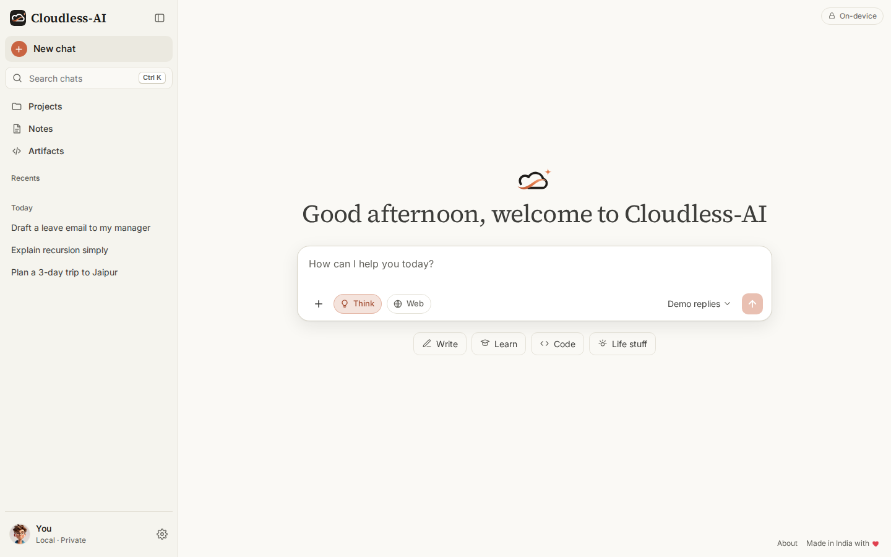</td>
    <td width="50%">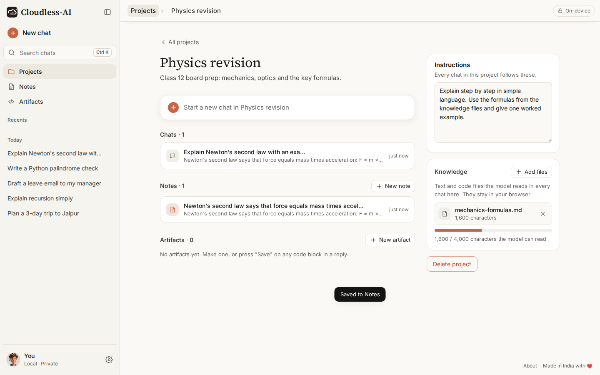</td>
  </tr>
  <tr>
    <td align="center">Start screen</td>
    <td align="center">A project: chats, notes, instructions, knowledge</td>
  </tr>
  <tr>
    <td>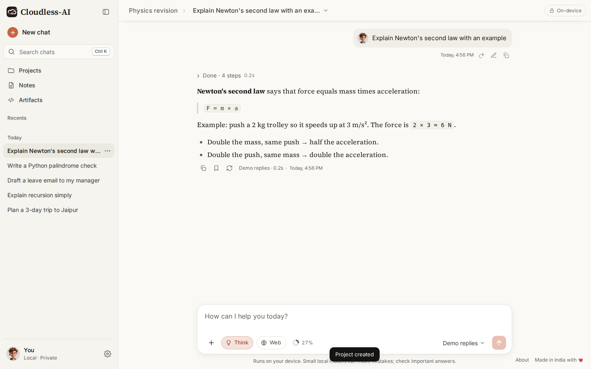</td>
    <td>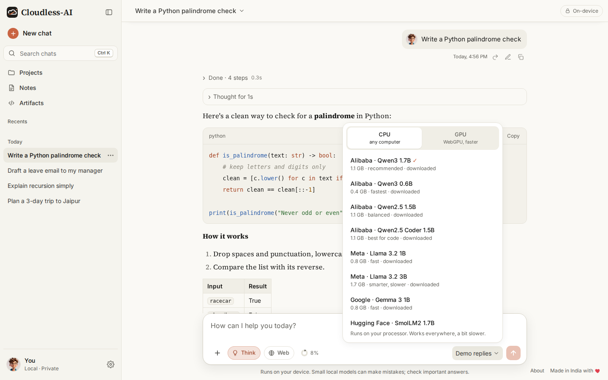</td>
  </tr>
  <tr>
    <td align="center">A chat inside a project</td>
    <td align="center">Pick a model; download only when you click</td>
  </tr>
  <tr>
    <td>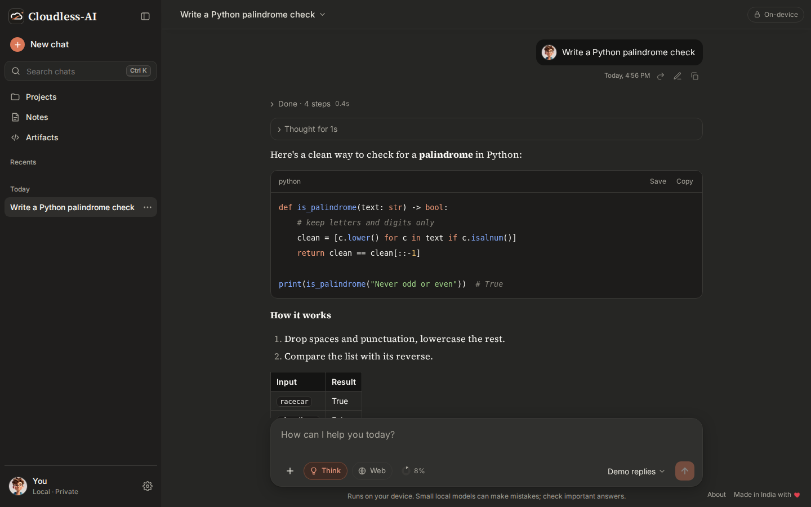</td>
    <td>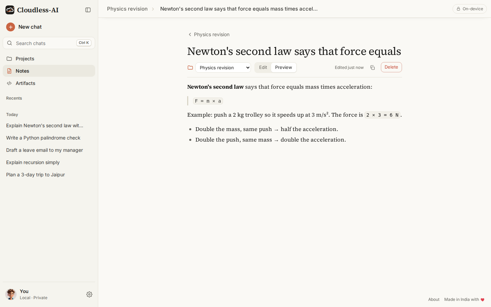</td>
  </tr>
  <tr>
    <td align="center">Dark theme</td>
    <td align="center">Notes, with an Edit / Preview switch</td>
  </tr>
  <tr>
    <td>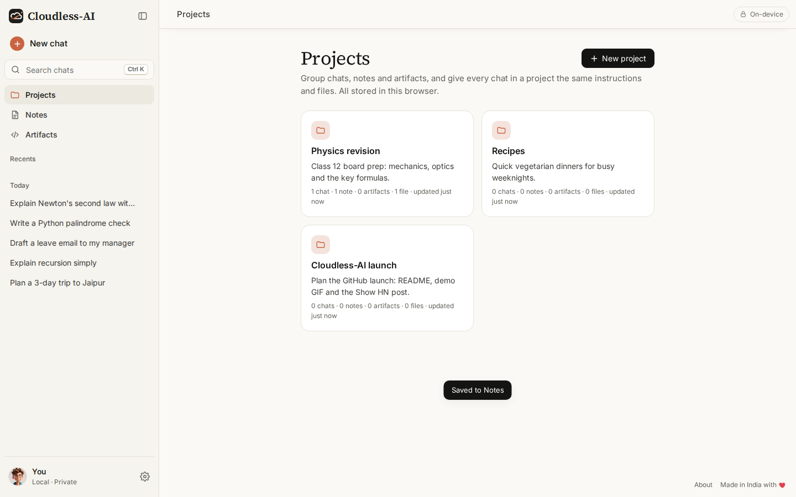</td>
    <td align="center">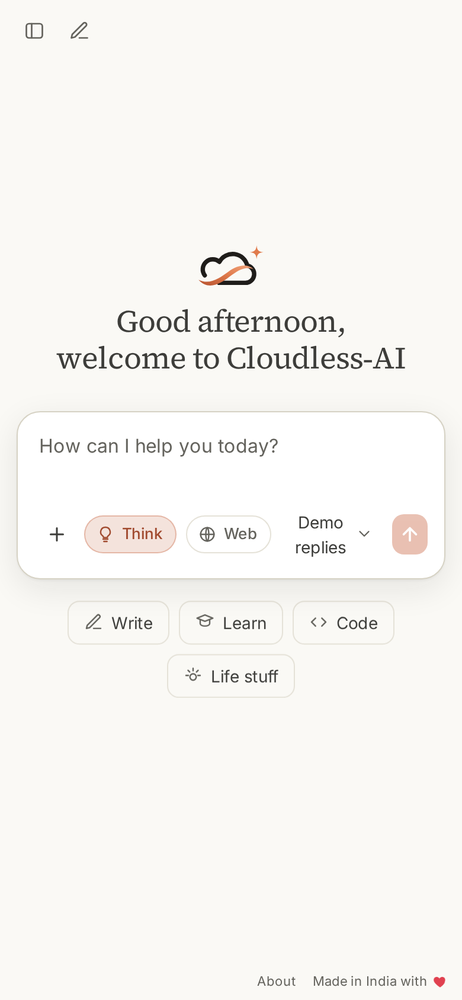&nbsp;&nbsp;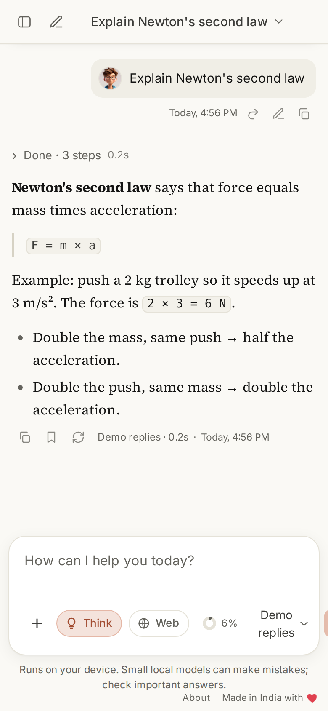</td>
  </tr>
  <tr>
    <td align="center">All your projects</td>
    <td align="center">On a phone</td>
  </tr>
</table>

<p align="center">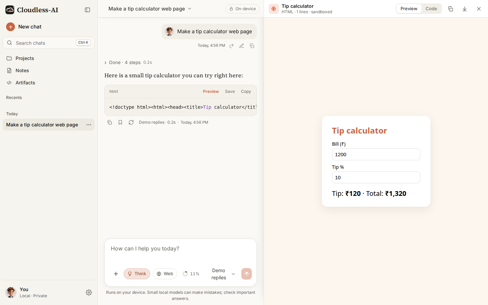<br><sub>A reply's web page runs in the side panel, like an artifact</sub></p>

<p align="center">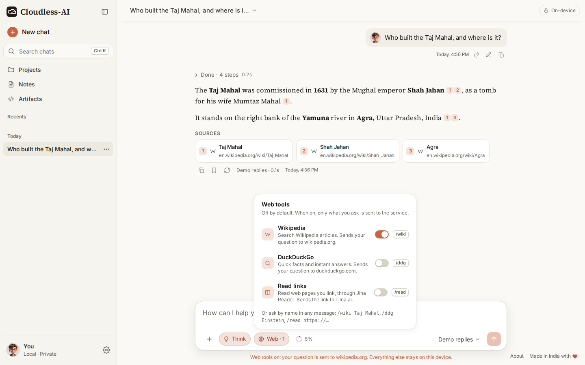<br><sub>Web tools: turn on Wikipedia, DuckDuckGo or link reading, and every answer shows its sources</sub></p>

<p align="center">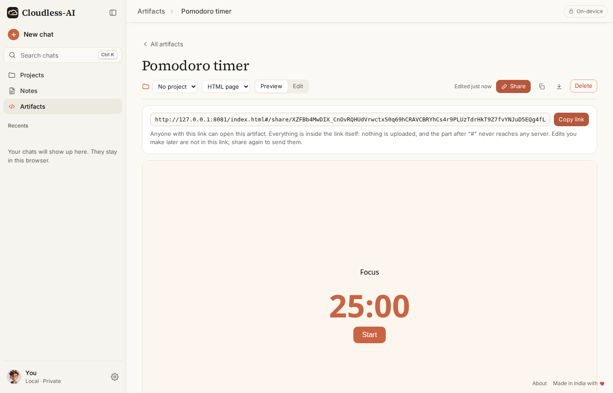<br><sub>Artifacts: keep pages, images, documents and code, and share any of them as a link that carries the whole artifact</sub></p>

<p align="center"><sub>Screenshots use scripted demo replies so they're repeatable. With a real model, the answers are its own.</sub></p>

## How it works

```
 you type ──► Cloudless-AI (this browser tab)
                 │
                 ├── chats, projects, notes ──► IndexedDB      (on your device)
                 ├── settings, name, photo  ──► localStorage   (on your device)
                 │
                 └── prompt = instructions + project files + recent messages
                         │
                         ▼
            ┌──────────── local model ────────────┐
            │ CPU: llama.cpp in WebAssembly (wllama)│   weights cached in your browser
            │ GPU: WebLLM over WebGPU               │   after the first download
            └──────────────────┬───────────────────┘
                               ▼
                 reply streams back word by word
```

No request in that loop leaves your machine. An automated test checks that a chat makes no network call outside the page's own origin.

The one exception is a web tool you turn on yourself. Then only the search words (or the link) go to that service, straight from your browser: Wikipedia, DuckDuckGo or Jina Reader. No account and no API key are used, and your chat history is never sent. A test checks that nothing is sent while the tools are off.

## Local models

Pick one from the model menu under the message box. Each downloads once.

| Mode | Models | Size | Needs |
|---|---|---|---|
| **CPU** (default) | Qwen3 1.7B (recommended) · Qwen3 0.6B · Qwen2.5 1.5B · Qwen2.5 Coder 1.5B · Llama 3.2 1B / 3B · Gemma 3 1B · SmolLM2 1.7B · Phi-3.5 mini | 0.4 to 1.7 GB | Any modern browser |
| **GPU** | Qwen2.5 1.5B · Qwen3 1.7B · Gemma 2 2B · Llama 3.2 3B · Phi-3.5 mini · Llama 3.1 8B | 1.6 to 5 GB of GPU memory | A browser with WebGPU (Chrome, Edge) |

On a normal laptop, Qwen3 0.6B on the CPU loaded in about 50 seconds the first time and answered a short question in 2 to 3 seconds.

**Be realistic about size.** These are small models. They're good for drafting, explaining, summarising and simple code. They make more mistakes than big hosted models. By default they read 4,000 tokens at a time; for long chats the app sends your instructions plus the most recent messages that fit. Nothing gets deleted; the model just doesn't see the oldest turns.

**Need more memory?** Settings → **Context window**. A bigger window holds more, costs RAM and makes replies slower to start:

| Context | Fits about | Extra RAM (Qwen3 1.7B) | Tested with Qwen3 0.6B on a laptop CPU |
|---|---|---|---|
| 4K (default) | 5 pages | ~0.45 GB | – |
| 8K | 10 pages | ~0.9 GB | Found a code word at the start of a 21,000-character prompt in 23 s |
| 16K | 20 pages | ~1.8 GB | Found it in a 42,000-character prompt in 47 s |
| 32K | 40 pages | ~3.6 GB | GPU mode, or small-cache models like Llama 3.2 1B |

CPU mode runs inside WebAssembly, which caps a tab at 4 GB, so each model offers only the sizes that fit next to its weights.

## Where your data lives

| What | Where | Lasts until |
|---|---|---|
| Chats, projects, notes, artifacts | IndexedDB (`cloudless`) | You delete them, or use "Delete all data" |
| Settings, name, photo | localStorage (`cloudless.settings`) | Same |
| CPU model files | Origin Private File System | Same |
| GPU model files | Cache Storage | Same |
| The model's working memory | RAM, in the tab | You close the tab |

The network is used for three things only: loading the app, downloading model weights from Hugging Face the first time, and (GPU mode only) loading the WebLLM library from a CDN.

A shared artifact link carries the artifact itself after the `#`. Browsers never send that part to a server, so the content goes only where you send the link. Anyone who has the link can open it, so share it like you would share the file. Shared HTML runs in a sandbox with no network and no access to the app's data.

## How it compares

| | Cloudless-AI | ChatGPT, Claude.ai | Ollama + Open WebUI, LM Studio |
|---|---|---|---|
| Where the model runs | Your browser tab | Their servers | An app you install on your computer |
| Install | None, open a link | None | Install and run a local server |
| Account or key | None | Account required | None |
| Model size | Small (0.5 to 8B) | The largest models | Anything your hardware can run |
| Cost | Free, MIT | Free tiers, paid plans | Free |

Fair warning: hosted models are far smarter, and desktop tools like Ollama or LM Studio run bigger models faster. Cloudless-AI is for when you want zero install and zero data leaving the device, from any computer with a browser.

## FAQ

**Does anything get sent to a server?**
No chats, notes or files. The model runs in your tab and everything is saved in your browser.

**Do I need a GPU?**
No. CPU mode works on any computer. If your browser has WebGPU, switch to GPU in the model menu for faster replies.

**Why does the page reload once on the first visit?**
Multi-threaded CPU inference needs cross-origin isolation. Static hosts like GitHub Pages can't set those headers, so `coi-serviceworker.js` adds them and reloads once.

**Can I use it offline?**
Yes, once the app and a model have loaded one time.

**Can the model read my PDFs?**
Yes, PDFs that contain text. The text is read in your browser with [pdf.js](https://mozilla.github.io/pdf.js/) (loaded only the first time you attach a PDF) and given to the model, and the PDF also opens in the side panel. Scanned PDFs, which are only pictures, can't be read yet; the live status says so. A small model's 4K memory holds about the first 6,000 characters of each file, so ask about a part or paste the section you need for long documents. You can add PDFs to a project too.

**Is the HTML preview safe?**
It runs in a sandboxed frame with its own empty origin and a content policy that blocks all network requests, so a page can't read your chats or send data anywhere.

**How do I remove everything?**
Settings → **Delete all data**. It removes Cloudless-AI's chats, projects, notes, settings and the models it downloaded.

**Will that touch my other apps?**
No. Other apps can share the same site (on GitHub Pages every repo of an account does), so the reset removes only Cloudless-AI's own database, its `cloudless.*` settings, the model files it downloaded itself and its own service worker. A model another app downloaded first stays put.

## Deploy

There is nothing to compile: the repository root is the site. The live demo is a clean copy of it (no screenshots) on GitHub Pages, and any static host works the same way: upload the files and open `index.html`.

The app is checked by 103 end-to-end tests that drive it in headless Chromium with a mock model (pytest + Playwright). They are kept outside this repository.

## Project layout

```
index.html            page shell, SEO tags
about.html            static About page: features, models, privacy, FAQ (no JavaScript needed)
llms.txt              plain summary for AI assistants (llmstxt.org)
css/app.css           warm light and dark themes
css/about.css         About page styles
js/app.js             chat screen, sidebar, header menu, model menu, settings
js/pages.js           Projects, Notes and Artifacts pages
js/artifacts.js       artifact kinds, share links (compress into the URL), sandbox
js/llm.js             CPU (wllama) and GPU (WebLLM) engines, streaming
js/chats.js           prompt building, project knowledge budget, titles
js/tools.js           web tools: Wikipedia, DuckDuckGo, Jina Reader
js/markdown.js        safe Markdown renderer (escapes all HTML)
js/highlight.js       tiny code highlighter
js/storage.js         IndexedDB and localStorage, "Delete all data"
vendor/wllama/        llama.cpp WebAssembly runtime (MIT)
vendor/fonts/         Source Serif 4 and Inter (SIL OFL 1.1)
coi-serviceworker.js  cross-origin isolation for multi-threading (MIT)
```

## Why JavaScript?

My projects are Python by default. Here that isn't possible: the whole app has to run inside a browser tab with no backend, so it's plain JavaScript (ES modules, no build step). The tests are Python.

## Contributing

Issues and pull requests are welcome. Run it locally with `python3 -m http.server 8081` and add `?mock=1` to try the UI without a model download. Keep everything in the browser: no backend, no analytics. For a bug, mention your browser, CPU or GPU mode, and the model you picked.

## Credits

[wllama](https://github.com/ngxson/wllama) and [llama.cpp](https://github.com/ggml-org/llama.cpp) for CPU inference, [WebLLM](https://github.com/mlc-ai/web-llm) for GPU inference, [coi-serviceworker](https://github.com/gzuidhof/coi-serviceworker), [pdf.js](https://github.com/mozilla/pdf.js) (Apache-2.0) for reading PDFs, and the [Source Serif 4](https://github.com/adobe-fonts/source-serif) and [Inter](https://rsms.me/inter/) fonts. Model weights come from their authors on Hugging Face under their own licenses. The optional web tools use the [Wikipedia API](https://www.mediawiki.org/wiki/API:Main_page) (article text is CC BY-SA 4.0; every reply links its sources), the [DuckDuckGo Instant Answer API](https://duckduckgo.com/duckduckgo-help-pages/open-source/instant-answer-interface/) and [Jina Reader](https://jina.ai/reader/), each under its own terms.

## License

[MIT](LICENSE)

---

<div align="center">

Built by [Lokendra Singh Rathore](https://github.com/lokendra-builds) · Made in India with ❤️

<sub>Not affiliated with Anthropic, OpenAI or Google. Product names belong to their owners.</sub>

<br />

**If this is useful to you:**

[](https://github.com/lokendra-builds/Cloudless-AI/stargazers)

</div>
